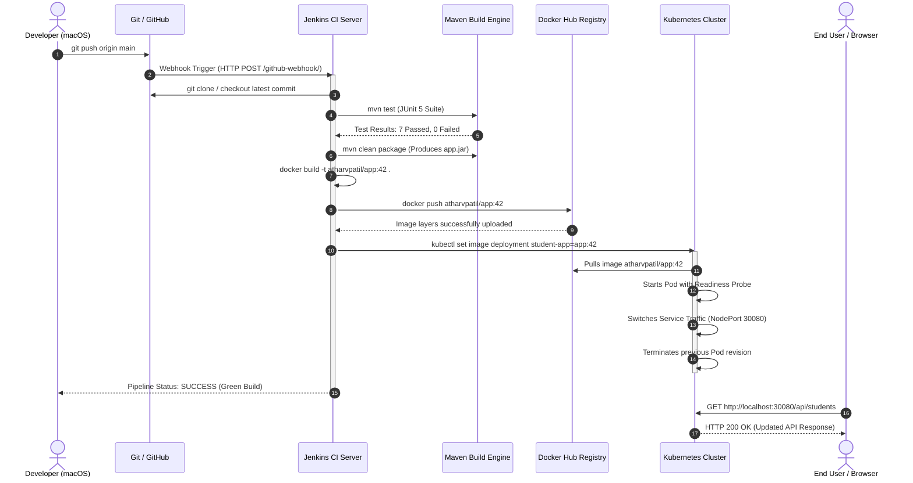

# DevOps Student Management System: Hands-On Implementation Guide
## Taking a Spring Boot Application from Local Code to Automated Cloud-Native Kubernetes Deployment

> **Target Audience:** DevOps Beginners, Junior DevOps Engineers, Software Engineering Students, Technical Interview Aspirants  
> **Application:** DevOps Student Management System (Spring Boot + MySQL + Maven)  
> **Platform:** macOS (Apple Silicon / Intel) with cross-platform notes  
> **Tools Covered:** Java 17, Apache Maven, Git, GitHub, GitFlow, Jenkins, Docker, Docker Compose, Kubernetes (kubectl), Postman

---

## Table of Contents

1. [Project Overview & Architectural Blueprint](#1-project-overview--architectural-blueprint)
2. [Phase 1: Java and Maven (Local Development & Build Automation)](#phase-1-java-and-maven-local-development--build-automation)
   * 1.1 Install and Configure Java 17 on macOS
   * 1.2 Verify Java Environment
   * 1.3 Understanding Apache Maven Philosophy
   * 1.4 Project Directory Structure Breakdown
   * 1.5 Understanding `pom.xml` Line by Line
   * 1.6 Executing Maven Lifecycle Commands
   * 1.7 Running the Spring Boot Application Locally
   * 1.8 Testing REST APIs with Postman & cURL
3. [Phase 2: Git and GitHub (Version Control & Team GitFlow)](#phase-2-git-and-github-version-control--team-gitflow)
   * 2.1 Git Initialization & Identity Configuration
   * 2.2 Connecting to Remote GitHub Repository
   * 2.3 Staging, Committing, and Pushing Code
   * 2.4 Branching & Merging Fundamentals
   * 2.5 Simulating and Resolving Merge Conflicts
   * 2.6 Pull Request (PR) Workflow & Code Review
   * 2.7 Implementing the Enterprise GitFlow Model
4. [Phase 3: Jenkins (Continuous Integration & Automation)](#phase-3-jenkins-continuous-integration--automation)
   * 3.1 Jenkins Architecture: Controller, Agents, Workspaces, and Plugins
   * 3.2 Running Jenkins via Docker on macOS
   * 3.3 Initial Setup & Administrator Configuration
   * 3.4 Creating a Freestyle Project
   * 3.5 Integrating Jenkins with GitHub SCM & Automated Triggers
   * 3.6 Transitioning to Pipeline as Code (Declarative Jenkinsfile)
5. [Phase 4: Docker (Containerization & Local Multi-Container Orchestration)](#phase-4-docker-containerization--local-multi-container-orchestration)
   * 4.1 Understanding Images, Containers, and Kernel Virtualization
   * 4.2 Verifying Docker Desktop on macOS
   * 4.3 Multi-Stage Dockerfile Analysis for Java Applications
   * 4.4 Building, Running, Inspecting, and Debugging Containers
   * 4.5 Docker Networking Deep Dive (Bridge, Host, DNS Resolution)
   * 4.6 Docker Volumes & Persistent Storage
   * 4.7 Multi-Container Orchestration with Docker Compose (Spring Boot + MySQL)
6. [Phase 5: Jenkins + Docker CI/CD Integration](#phase-5-jenkins--docker-cicd-integration)
   * 5.1 Docker-outside-of-Docker (DooD) Architecture via `/var/run/docker.sock`
   * 5.2 Configuring Docker Hub Credentials in Jenkins
   * 5.3 Complete Declarative Jenkinsfile Walkthrough
   * 5.4 Automated Image Tagging, Registry Push, and Container Deployment
7. [Phase 6: Kubernetes (Cloud-Native Container Orchestration)](#phase-6-kubernetes-cloud-native-container-orchestration)
   * 6.1 Kubernetes Architecture: Control Plane & Worker Nodes
   * 6.2 Core Primitives: Pods, ReplicaSets, Deployments, and Services
   * 6.3 Enabling Kubernetes on Docker Desktop & Verifying `kubectl`
   * 6.4 Authoring `deployment.yaml` with Probes and Resource Limits
   * 6.5 Authoring `service.yaml` (NodePort & ClusterIP)
   * 6.6 Deploying and Monitoring the Application Cluster
   * 6.7 Dynamic Auto-Scaling, Rolling Updates, and Instant Rollback
8. [Phase 7: Complete End-to-End Enterprise DevOps Workflow](#phase-7-complete-end-to-end-enterprise-devops-workflow)
   * 7.1 Full System Flow Diagram
   * 7.2 Step-by-Step Execution Trace (Commit to Live Zero-Downtime Deployment)
9. [Phase 8: Comprehensive Troubleshooting Guide](#phase-8-comprehensive-troubleshooting-guide)
   * 8.1 Common Java & Maven Errors
   * 8.2 Git & GitHub Authentication Errors
   * 8.3 Jenkins Pipeline Failures
   * 8.4 Docker Image & Container Errors
   * 8.5 Docker Networking & DNS Errors
   * 8.6 Kubernetes Pod Failures (`CrashLoopBackOff`, `OOMKilled`)
   * 8.7 Kubernetes Image Pull Failures (`ImagePullBackOff`)
   * 8.8 Port Conflicts & Resolution on macOS
   * 8.9 Database Connection & Network Link Errors
10. [Phase 9: Master DevOps Interview Question Pack](#phase-9-master-devops-interview-question-pack)
   * 9.1 50 General DevOps Interview Questions & Answers
   * 9.2 20 Real-World Scenario-Based Questions & Answers
   * 9.3 20 Practical Command-Based Technical Questions & Answers
   * 9.4 10 Project-Specific Questions on the DevOps Student Management System

---

# 1. Project Overview & Architectural Blueprint

The **DevOps Student Management System** is a production-style, beginner-friendly RESTful web service built with **Spring Boot 3**, **Java 17**, and **MySQL**. It provides 5 core CRUD operations:
1. **Add Student** (`POST /api/students`)
2. **View All Students** (`GET /api/students`)
3. **Search Student by ID** (`GET /api/students/{id}`)
4. **Update Student Details** (`PUT /api/students/{id}`)
5. **Delete Student** (`DELETE /api/students/{id}`)
6. **Health Check** (`GET /api/students/health`)

### The DevOps Transformation Journey
Instead of treating DevOps as disconnected abstract concepts, this guide leads you through the complete transformation lifecycle:

```
[ Local Java Code ] 
         |
         v (Phase 1: Maven Build & JUnit 5 Tests)
[ Packaged JAR ]
         |
         v (Phase 2: Git Version Control & GitHub Flow)
[ GitHub Repository ]
         |
         v (Phase 3 & 5: Jenkins Pipeline Automation)
[ Automated CI Pipeline ]
         |
         v (Phase 4: Docker Multi-Stage Packaging)
[ Docker Container Image ]
         |
         v (Phase 5: Docker Hub Registry Push)
[ Secure Registry ]
         |
         v (Phase 6: Kubernetes Deployment & Services)
[ High-Availability Kubernetes Cluster ]
```

---

# Phase 1: Java and Maven (Local Development & Build Automation)

## 1.1 Install and Configure Java 17 on macOS
Spring Boot 3 requires Java 17 (or newer) LTS. On macOS, the cleanest installation method is via Homebrew:

```bash
# 1. Update Homebrew formulae
brew update

# 2. Install OpenJDK 17 LTS
brew install openjdk@17

# 3. Configure environment variables in Zsh shell profile
echo 'export PATH="/opt/homebrew/opt/openjdk@17/bin:$PATH"' >> ~/.zshrc
echo 'export JAVA_HOME=$(/usr/libexec/java_home -v 17 2>/dev/null || echo "/opt/homebrew/opt/openjdk@17")' >> ~/.zshrc

# 4. Reload shell configuration
source ~/.zshrc
```
* **Why we do this:** Without `JAVA_HOME`, build tools like Maven cannot find the Java compiler (`javac`) or standard libraries.

## 1.2 Verify Java Environment
```bash
java -version
javac -version
echo $JAVA_HOME
```
* **Expected Output:**
  ```text
  openjdk version "17.0.x" ...
  javac 17.0.x
  /opt/homebrew/opt/openjdk@17
  ```

## 1.3 Understanding Apache Maven Philosophy
Maven is much more than a compiler wrapper; it provides:
* **Standardized Directory Structure:** Every Maven project has the exact same layout. An engineer familiar with Maven can navigate any enterprise repository instantly.
* **Declarative Dependency Management:** Instead of downloading `.jar` files and committing them to Git, you declare coordinates in `pom.xml`. Maven resolves, downloads, and caches all direct and transitive dependencies.
* **Predictable Build Lifecycles:** Standard phases (`compile`, `test`, `package`) ensure uniform commands across development, CI servers, and production environments.

## 1.4 Project Directory Structure Breakdown
Navigate to the project root:

```bash
cd /Users/atharv/Desktop/devops/DevOps-Learning/devops-student-management
```

The application is structured as follows:

```text
devops-student-management/
├── pom.xml                                   <-- Build definition & dependencies
├── Dockerfile                                <-- Multi-stage container recipe
├── docker-compose.yml                        <-- Local multi-container topology
├── Jenkinsfile                               <-- Declarative CI/CD pipeline
├── .gitignore                                <-- Excluded files (target/, .idea/)
│
├── database/
│   └── schema.sql                            <-- MySQL table initialization & seed data
│
├── k8s/
│   ├── deployment.yaml                       <-- Kubernetes Pod & Deployment spec
│   └── service.yaml                          <-- Kubernetes NodePort Service spec
│
└── src/
    ├── main/
    │   ├── java/com/devops/studentmanagement/
    │   │   ├── StudentManagementApplication.java   <-- Spring Boot entry point
    │   │   ├── controller/
    │   │   │   └── StudentController.java          <-- RESTful API endpoints
    │   │   ├── entity/
    │   │   │   └── Student.java                    <-- JPA Entity (MySQL mapping)
    │   │   ├── repository/
    │   │   │   └── StudentRepository.java          <-- Spring Data JPA interface
    │   │   ├── service/
    │   │   │   ├── StudentService.java             <-- Business service interface
    │   │   │   └── impl/StudentServiceImpl.java    <-- Business logic implementation
    │   │   └── exception/
    │   │       ├── ResourceNotFoundException.java  <-- Custom 404 exception
    │   │       └── GlobalExceptionHandler.java     <-- Structured error responses
    │   └── resources/
    │       └── application.properties              <-- MySQL runtime configuration
    └── test/
        ├── java/com/devops/studentmanagement/
        │   ├── StudentManagementApplicationTests.java <-- Spring context test
        │   └── StudentServiceTests.java            <-- Mockito unit tests
        └── resources/
            └── application.properties              <-- H2 in-memory test configuration
```

## 1.5 Understanding `pom.xml` Line by Line
The `pom.xml` file controls the build. Let's analyze the critical sections:

1. **Parent POM:**
   ```xml
   <parent>
       <groupId>org.springframework.boot</groupId>
       <artifactId>spring-boot-starter-parent</artifactId>
       <version>3.3.5</version>
   </parent>
   ```
   * *Purpose:* Inherits battle-tested default plugin settings, compiler flags, and dependency management versions from Spring Boot, eliminating version numbers from individual dependencies.
2. **Project Coordinates (GAV):**
   ```xml
   <groupId>com.devops</groupId>
   <artifactId>devops-student-management</artifactId>
   <version>1.0.0</version>
   ```
   * *Purpose:* Uniquely identifies this artifact across the company and in container repositories.
3. **Core Dependencies:**
   * `spring-boot-starter-web`: Embeds Apache Tomcat and configures Spring MVC for JSON REST endpoints.
   * `spring-boot-starter-data-jpa`: Bundles Hibernate ORM, reducing boilerplate SQL into simple Java repository interfaces.
   * `mysql-connector-j`: The official JDBC driver enabling Java to communicate with MySQL databases over TCP port 3306.
   * `h2`: In-memory database used exclusively during automated tests so CI builds never fail if MySQL is offline.
   * `spring-boot-starter-test`: Bundles JUnit 5, Mockito, and AssertJ for automated testing.
4. **Spring Boot Maven Plugin:**
   ```xml
   <plugin>
       <groupId>org.springframework.boot</groupId>
       <artifactId>spring-boot-maven-plugin</artifactId>
   </plugin>
   ```
   * *Purpose:* Packages the application as an executable "Fat JAR" containing both compiled code and all dependency libraries, runnable with `java -jar app.jar`.

## 1.6 Executing Maven Lifecycle Commands
Always execute these commands from inside `DevOps-Learning/devops-student-management`:

### 1. `mvn clean`
* **What it does:** Deletes the `target/` directory generated by previous builds.
* **Why we use it:** Ensures stale compiled classes or cached files do not contaminate the new build.
* **Command:**
  ```bash
  mvn clean
  ```

### 2. `mvn compile`
* **What it does:** Reads source files from `src/main/java`, checks Java syntax, and compiles them into bytecode `.class` files placed inside `target/classes/`.
* **Command:**
  ```bash
  mvn compile
  ```

### 3. `mvn test`
* **What it does:** Compiles test classes from `src/test/java` and executes all automated unit and integration tests using the Maven Surefire Plugin.
* **Command:**
  ```bash
  mvn test
  ```
* **Expected Output:**
  ```text
  [INFO] Running com.devops.studentmanagement.StudentServiceTests
  [INFO] Tests run: 6, Failures: 0, Errors: 0, Skipped: 0
  [INFO] Running com.devops.studentmanagement.StudentManagementApplicationTests
  [INFO] Tests run: 1, Failures: 0, Errors: 0, Skipped: 0
  [INFO] BUILD SUCCESS
  ```

### 4. `mvn package`
* **What it does:** Executes `validate` -> `compile` -> `test` -> bundles compiled classes into the executable JAR file `target/devops-student-management-1.0.0.jar`.
* **Command:**
  ```bash
  mvn package
  ```

### 5. `mvn install`
* **What it does:** Copies the packaged JAR into your local user repository (`~/.m2/repository/com/devops/devops-student-management/1.0.0/`).
* **Command:**
  ```bash
  mvn install
  ```

## 1.7 Running the Application Locally
You can run the application directly via the Spring Boot Maven plugin:

```bash
mvn spring-boot:run
```
Or run the packaged JAR directly with the Java runtime:

```bash
java -jar target/devops-student-management-1.0.0.jar
```
* **Expected Console Output:**
  ```text
  =================================================
   DevOps Student Management Application Started!  
   Ready to accept API requests on port 8080       
  =================================================
  Tomcat started on port 8080 (http) with context path '/'
  ```

## 1.8 Testing REST APIs with Postman & cURL
While the application is running, open a new terminal window to execute API requests or import these into Postman.

### 1. Health Check
* **Endpoint:** `GET http://localhost:8080/api/students/health`
* **cURL Command:**
  ```bash
  curl -X GET http://localhost:8080/api/students/health
  ```
* **Expected JSON Response (HTTP 200 OK):**
  ```json
  {
    "service": "devops-student-management",
    "message": "Application is healthy and running smoothly!",
    "status": "UP"
  }
  ```

### 2. Add a Student (Create)
* **Endpoint:** `POST http://localhost:8080/api/students`
* **Headers:** `Content-Type: application/json`
* **cURL Command:**
  ```bash
  curl -X POST http://localhost:8080/api/students \
    -H "Content-Type: application/json" \
    -d '{
      "firstName": "Atharv",
      "lastName": "Patil",
      "email": "atharv.patil@example.com",
      "department": "Computer Science & Engineering",
      "semester": 6
    }'
  ```
* **Expected JSON Response (HTTP 201 Created):**
  ```json
  {
    "id": 1,
    "firstName": "Atharv",
    "lastName": "Patil",
    "email": "atharv.patil@example.com",
    "department": "Computer Science & Engineering",
    "semester": 6
  }
  ```

### 3. View All Students (Read All)
* **Endpoint:** `GET http://localhost:8080/api/students`
* **cURL Command:**
  ```bash
  curl -X GET http://localhost:8080/api/students
  ```
* **Expected JSON Response (HTTP 200 OK):**
  ```json
  [
    {
      "id": 1,
      "firstName": "Atharv",
      "lastName": "Patil",
      "email": "atharv.patil@example.com",
      "department": "Computer Science & Engineering",
      "semester": 6
    }
  ]
  ```

### 4. Search Student by ID (Read One)
* **Endpoint:** `GET http://localhost:8080/api/students/1`
* **cURL Command:**
  ```bash
  curl -X GET http://localhost:8080/api/students/1
  ```
* **Expected JSON Response (HTTP 200 OK):**
  ```json
  {
    "id": 1,
    "firstName": "Atharv",
    "lastName": "Patil",
    "email": "atharv.patil@example.com",
    "department": "Computer Science & Engineering",
    "semester": 6
  }
  ```

### 5. Update Student Details (Update)
* **Endpoint:** `PUT http://localhost:8080/api/students/1`
* **Headers:** `Content-Type: application/json`
* **cURL Command:**
  ```bash
  curl -X PUT http://localhost:8080/api/students/1 \
    -H "Content-Type: application/json" \
    -d '{
      "firstName": "Atharv",
      "lastName": "Patil",
      "email": "atharv.senior@example.com",
      "department": "Artificial Intelligence & Data Science",
      "semester": 7
    }'
  ```
* **Expected JSON Response (HTTP 200 OK):**
  ```json
  {
    "id": 1,
    "firstName": "Atharv",
    "lastName": "Patil",
    "email": "atharv.senior@example.com",
    "department": "Artificial Intelligence & Data Science",
    "semester": 7
  }
  ```

### 6. Delete Student (Delete)
* **Endpoint:** `DELETE http://localhost:8080/api/students/1`
* **cURL Command:**
  ```bash
  curl -X DELETE http://localhost:8080/api/students/1
  ```
* **Expected JSON Response (HTTP 200 OK):**
  ```json
  {
    "message": "Student successfully deleted with ID: 1"
  }
  ```

---

# Phase 2: Git and GitHub (Version Control & Team GitFlow)

## 2.1 Git Initialization & Identity Configuration
Inside `devops-student-management`, initialize Git tracking:

```bash
cd /Users/atharv/Desktop/devops/DevOps-Learning/devops-student-management

# Configure your global or repository identity
git config user.name "Atharv Patil"
git config user.email "atharv.patil@example.com"

# Initialize local Git repository
git init
```

## 2.2 Connecting to Remote GitHub Repository
1. Log in to [GitHub](https://github.com) -> Click **New Repository**.
2. Name: `devops-student-management`.
3. Set visibility to **Public** -> Leave all initialization checkboxes unselected.
4. Link your local repository to GitHub:

```bash
git remote add origin https://github.com/your-username/devops-student-management.git
git branch -M main
```

## 2.3 Staging, Committing, and Pushing Code
```bash
# Check working tree status
git status

# Stage all project files (honors .gitignore)
git add .

# Create initial commit
git commit -m "feat: initial commit of DevOps Student Management System with Maven & JPA"

# Push to GitHub
git push -u origin main
```

## 2.4 Branching & Merging Fundamentals
Never develop features directly on `main`. Create an isolated feature branch:

```bash
# Create and switch to new branch
git checkout -b feature/search-filter

# Implement a change (e.g., add a comment in StudentController.java)
# Stage and commit change
git add src/main/java/com/devops/studentmanagement/controller/StudentController.java
git commit -m "feat(api): add logging annotation to search endpoint"

# Push feature branch to GitHub
git push -u origin feature/search-filter
```

## 2.5 Simulating and Resolving Merge Conflicts
A merge conflict occurs when two branches modify the exact same line in a file differently. Let's simulate and resolve one:

### Step 1: Create Conflicting Commits on Two Branches
```bash
# Switch to main
git checkout main

# Edit line in application.properties
echo "app.environment=PRODUCTION_ENVIRONMENT" >> src/main/resources/application.properties
git add src/main/resources/application.properties
git commit -m "chore: set environment to production on main"

# Switch to feature branch
git checkout -b feature/env-config

# Edit the EXACT SAME line in application.properties
echo "app.environment=DEVELOPMENT_ENVIRONMENT" >> src/main/resources/application.properties
git add src/main/resources/application.properties
git commit -m "chore: set environment to development on feature branch"
```

### Step 2: Attempt to Merge Feature into Main
```bash
git checkout main
git merge feature/env-config
```
* **Expected Output:**
  ```text
  Auto-merging src/main/resources/application.properties
  CONFLICT (content): Merge conflict in src/main/resources/application.properties
  Automatic merge failed; fix conflicts and then commit the result.
  ```

### Step 3: Inspect Conflict Markers
Open `src/main/resources/application.properties`. Git inserts conflict markers:
```text
<<<<<<< HEAD
app.environment=PRODUCTION_ENVIRONMENT
=======
app.environment=DEVELOPMENT_ENVIRONMENT
>>>>>>> feature/env-config
```

### Step 4: Resolve and Finalize Merge
Edit the file to choose the intended value or combine them using dynamic environment variables:
```text
app.environment=${APP_ENV:PRODUCTION_ENVIRONMENT}
```
Stage the resolved file and commit:
```bash
git add src/main/resources/application.properties
git commit -m "fix(merge): resolve environment configuration conflict between main and feature"
git push origin main
```
* **Conflict successfully resolved!**

## 2.6 Pull Request (PR) Workflow & Code Review
1. Push your feature branch: `git push origin feature/search-filter`.
2. On GitHub, navigate to **Pull requests** -> Click **New pull request**.
3. Set **Base:** `main`  <--  **Compare:** `feature/search-filter`.
4. Add description detailing changes and test evidence -> Click **Create pull request**.
5. Teammates review the diff in the **Files changed** tab, submit reviews, and approve.
6. Click **Merge pull request** -> **Confirm merge**.
7. Clean up locally:
   ```bash
   git checkout main
   git pull origin main
   git branch -d feature/search-filter
   ```

## 2.7 Implementing the Enterprise GitFlow Model
The GitFlow branching model organizes development into clear operational phases:

```
                  (hotfix/db-connection) -------------------+
                            ^                               |
                            |                               v
  [ main ] -----------------+------------------------* (v1.0.0) -------* (v1.0.1)
     |                                               ^
     |                                               |
     v                                         [ release/v1.0 ]
  [ develop ] -------*-----------*-------------------+
         |           ^           ^
         |           |           |
         +--> [ feature/auth ] --+
```

### Complete GitFlow Execution Commands:
```bash
# 1. Establish the develop branch from main
git checkout -b develop
git push -u origin develop

# 2. Develop a feature
git checkout -b feature/pagination develop
# (make edits)
git commit -am "feat: implement student list pagination"
git checkout develop
git merge --no-ff feature/pagination
git push origin develop

# 3. Cut a release branch when features are ready
git checkout -b release/v1.0.0 develop
# (bump versions, update release notes)
git commit -am "chore(release): bump version to 1.0.0"

# 4. Finalize release into main and develop
git checkout main
git merge --no-ff release/v1.0.0
git tag -a v1.0.0 -m "Production Release v1.0.0"
git push origin main --tags

git checkout develop
git merge --no-ff release/v1.0.0
git push origin develop
git branch -d release/v1.0.0

# 5. Handle an urgent production hotfix
git checkout -b hotfix/null-pointer-fix main
# (apply fix)
git commit -am "fix(prod): resolve null pointer in search endpoint"
git checkout main
git merge --no-ff hotfix/null-pointer-fix
git tag -a v1.0.1 -m "Hotfix Release v1.0.1"
git push origin main --tags

git checkout develop
git merge --no-ff hotfix/null-pointer-fix
git push origin develop
git branch -d hotfix/null-pointer-fix
```

---

# Phase 3: Jenkins (Continuous Integration & Automation)

## 3.1 Jenkins Architecture: Controller, Agents, Workspaces, and Plugins
Jenkins is the standard open-source automation engine in enterprise CI/CD. Its distributed architecture separates control logic from compute execution:

```
+---------------------------------------------------------------------------------------+
|                            JENKINS DISTRIBUTED ARCHITECTURE                           |
|                                                                                       |
|                                [ JENKINS CONTROLLER ]                                 |
|                       (UI, Authentication, Scheduler, Plugins)                       |
|                                          |                                            |
|                  +-----------------------+-----------------------+                    |
|                  | (JNLP / SSH)                                  | (JNLP / SSH)       |
|                  v                                               v                    |
|          [ AGENT NODE 1 ]                                [ AGENT NODE 2 ]             |
|   (Docker Container / macOS)                      (Linux Cloud VM / Worker)           |
|    - Isolated Workspace                            - Isolated Workspace               |
|    - Executes Maven & Tests                        - Builds Docker Images             |
+---------------------------------------------------------------------------------------+
```

* **Controller (formerly Master):** Handles scheduling, web interface, plugin management, and credential storage. It should not execute heavy builds directly in production.
* **Agent (formerly Slave):** Worker nodes that connect to the controller and execute build tasks inside an isolated directory called a **Workspace**.
* **Plugins:** Extend Jenkins with capabilities (Git, Maven Integration, Docker Pipeline, Slack).
* **Credentials:** Encrypted store managing SSH keys, API tokens, and registry passwords safely.

## 3.2 Running Jenkins via Docker on macOS
Run Jenkins inside a Docker container with persistent storage and Docker socket passthrough:

```bash
# Create volume for persistent Jenkins state
docker volume create jenkins_home

# Start Jenkins LTS container
docker run -d \
  --name jenkins \
  -p 8080:8080 \
  -p 50000:50000 \
  -v jenkins_home:/var/jenkins_home \
  -v /var/run/docker.sock:/var/run/docker.sock \
  --user root \
  --restart=unless-stopped \
  jenkins/jenkins:lts
```
* **Explanation:**
  * `-p 8080:8080`: Exposes the Jenkins web interface on port 8080.
  * `-v /var/run/docker.sock:/var/run/docker.sock`: Mounts the host Docker socket, allowing Jenkins to run Docker commands natively.

## 3.3 Initial Setup & Administrator Configuration
1. Open your browser and go to `http://localhost:8080`.
2. Retrieve the unlock password:
   ```bash
   docker exec jenkins cat /var/jenkins_home/secrets/initialAdminPassword
   ```
3. Paste the password -> Click **Continue**.
4. Click **Install suggested plugins**.
5. Create your First Admin User (Username: `admin`, Password: `adminpassword123`).
6. Click **Save and Finish** -> **Start using Jenkins**.

## 3.4 Creating a Freestyle Project
1. Click **New Item** -> Name: `Student-Management-Freestyle` -> Select **Freestyle project** -> Click **OK**.
2. **Source Code Management:** Select **Git** -> Repository URL: `https://github.com/your-username/devops-student-management.git` -> Branch: `*/main`.
3. **Build Triggers:** Check **Poll SCM** -> Schedule: `H/5 * * * *`.
4. **Build Steps:** Click **Add build step** -> **Invoke top-level Maven targets**:
   * Goals: `clean test package`
5. Click **Save** -> Click **Build Now**.
6. Open **Build #1** -> Click **Console Output** to observe Maven downloading dependencies and executing JUnit 5 tests.

## 3.5 Integrating Jenkins with GitHub SCM & Automated Triggers
To eliminate polling delay and make builds fire instantaneously when code is pushed:
1. Go to your GitHub repository -> **Settings** -> **Webhooks** -> **Add webhook**.
2. **Payload URL:** `http://<your-public-ip-or-ngrok>:8080/github-webhook/`
3. **Content type:** `application/json`
4. **Events:** "Just the push event".
5. Click **Add webhook**. Jenkins will now start builds within 500 milliseconds of every `git push`!

## 3.6 Transitioning to Pipeline as Code (Declarative Jenkinsfile)
Freestyle jobs are hard to version, audit, or migrate. Modern DevOps teams define pipelines using a versioned `Jenkinsfile` stored directly inside the code repository.

### Declarative Pipeline Syntax Elements:
* `pipeline { ... }`: The root block enclosing the entire declarative pipeline.
* `agent any`: Instructs Jenkins to run the pipeline on any available executor.
* `environment { ... }`: Defines reusable variables and credentials.
* `tools { ... }`: Automatically installs or references build tools (JDK, Maven).
* `stages { ... }`: Sequences distinct operational phases (`Checkout`, `Test`, `Build`).
* `steps { ... }`: Contains individual shell commands (`sh 'mvn test'`).
* `post { ... }`: Executes conditional logic (`always`, `success`, `failure`).

---

# Phase 4: Docker (Containerization & Local Multi-Container Orchestration)

## 4.1 Understanding Images, Containers, and Kernel Virtualization
* **Traditional Virtual Machine:** Duplicates an entire operating system kernel, hardware drivers, and system daemons. Slow, heavy, and wasteful.
* **Docker Container:** Uses Linux Kernel primitives—**Namespaces** (isolates processes, network, users, and mounts) and **cgroups** (limits CPU, memory, and disk I/O)—to create a sandbox running directly on the host kernel.
* **Docker Image:** An immutable snapshot made of read-only stacked layers.
* **Docker Container:** A running instance of an image with an ephemeral writable layer on top.

## 4.2 Verifying Docker Desktop on macOS
Ensure Docker Desktop is active on your Mac:

```bash
docker --version
docker info
```

## 4.3 Multi-Stage Dockerfile Analysis for Java Applications
Inspect the production-ready `Dockerfile` in `devops-student-management/Dockerfile`:

```dockerfile
# ------------------------------------------------------------------------------
# STAGE 1: Build Stage (Uses heavy Maven + JDK image)
# ------------------------------------------------------------------------------
FROM maven:3.9.6-eclipse-temurin-17-alpine AS builder

WORKDIR /build

# Copy pom.xml first to leverage Docker layer caching
COPY pom.xml .
RUN mvn dependency:go-offline -B || true

# Copy source code and build executable Fat JAR
COPY src ./src
RUN mvn clean package -DskipTests

# ------------------------------------------------------------------------------
# STAGE 2: Runtime Stage (Uses minimal JRE image)
# ------------------------------------------------------------------------------
FROM eclipse-temurin:17-jre-alpine

# Security: Run as unprivileged non-root user
RUN addgroup -S appgroup && adduser -S appuser -G appgroup
WORKDIR /app

# Copy ONLY the built JAR from the builder stage
COPY --from=builder /build/target/devops-student-management-1.0.0.jar app.jar
RUN chown -R appuser:appgroup /app

USER appuser
EXPOSE 8080

ENTRYPOINT ["sh", "-c", "java $JAVA_OPTS -jar app.jar"]
```

### Why Multi-Stage Builds are Crucial:
1. **Dramatic Size Reduction:** The Maven compiler image is ~800MB. The final runtime JRE image is ~180MB.
2. **Security Hardening:** The final production container does not contain Maven, compilers, source code files, or build scripts—reducing the attack surface for hackers.
3. **Layer Caching:** By copying `pom.xml` and running `dependency:go-offline` before copying `src/`, Docker caches all downloaded libraries. Subsequent code changes rebuild in 3 seconds instead of 3 minutes!

## 4.4 Building, Running, Inspecting, and Debugging Containers
Execute these commands from inside `devops-student-management`:

### 1. Build the Docker Image
```bash
docker build -t devops-student-management:1.0.0 .
```
* **Verify image:**
  ```bash
  docker images | grep devops-student-management
  ```

### 2. Run the Container
```bash
docker run -d \
  -p 8080:8080 \
  --name student-app \
  devops-student-management:1.0.0
```
* **Explanation:**
  * `-d`: Run in background (detached mode).
  * `-p 8080:8080`: Forward requests from host `localhost:8080` into container port `8080`.
  * `--name student-app`: Human-readable container name.

### 3. Check Running Containers
```bash
docker ps
```
* **Expected Output:**
  ```text
  CONTAINER ID   IMAGE                               STATUS         PORTS                    NAMES
  5a8b9c2d1e4f   devops-student-management:1.0.0     Up 5 seconds   0.0.0.0:8080->8080/tcp   student-app
  ```

### 4. View Container Logs
```bash
docker logs -f student-app
```
* Press `Ctrl + C` to stop following logs.

### 5. Inspect Internal Container State
```bash
docker exec -it student-app sh
# (Inside container)
whoami        # Returns: appuser (non-root)
pwd           # Returns: /app
ls -la        # Shows app.jar
exit
```

### 6. Stop and Remove Container
```bash
docker stop student-app
docker rm student-app
```

## 4.5 Docker Networking Deep Dive
Docker provides several network modes:
* **bridge (default):** Containers get private IPs (e.g., `172.17.0.2`). Containers on the default bridge cannot resolve each other by container name.
* **custom bridge network:** Containers attached to a user-defined network get **automatic DNS resolution**. Container `student-app` can talk to `mysql-db` simply using the hostname `mysql-db:3306`!
* **host:** Removes network isolation, sharing the host's networking stack directly.
* **none:** Completely isolates container with no network interfaces (loopback only).

## 4.6 Docker Volumes & Persistent Storage
Containers are ephemeral: when a container is removed, all changes in its writable layer vanish.
* **Named Volumes (`mysql_data:/var/lib/mysql`):** Docker manages storage inside `/var/lib/docker/volumes/`. Data survives container restarts and upgrades. Essential for databases!
* **Bind Mounts (`./database/schema.sql:/docker-entrypoint-initdb.d/schema.sql`):** Mounts a file from your host Mac directly into the container.

## 4.7 Multi-Container Orchestration with Docker Compose
Running an enterprise application requires orchestrating multiple interconnected services: the Spring Boot backend and the MySQL database.

Inspect `devops-student-management/docker-compose.yml`:

```yaml
version: '3.8'

services:
  mysql-db:
    image: mysql:8.0
    container_name: devops-mysql-db
    restart: unless-stopped
    environment:
      MYSQL_ROOT_PASSWORD: rootpassword
      MYSQL_DATABASE: studentdb
    ports:
      - "3306:3306"
    volumes:
      - mysql_data:/var/lib/mysql
      - ./database/schema.sql:/docker-entrypoint-initdb.d/schema.sql
    networks:
      - devops-network
    healthcheck:
      test: ["CMD", "mysqladmin", "ping", "-h", "localhost", "-u", "root", "-prootpassword"]
      interval: 10s
      timeout: 5s
      retries: 5
      start_period: 30s

  student-app:
    build:
      context: .
      dockerfile: Dockerfile
    image: devops-student-management:1.0.0
    container_name: devops-student-app
    restart: unless-stopped
    ports:
      - "8080:8080"
    environment:
      DB_URL: jdbc:mysql://mysql-db:3306/studentdb?createDatabaseIfNotExist=true&useSSL=false&allowPublicKeyRetrieval=true&serverTimezone=UTC
      DB_USERNAME: root
      DB_PASSWORD: rootpassword
    depends_on:
      mysql-db:
        condition: service_healthy
    networks:
      - devops-network

volumes:
  mysql_data:
    driver: local

networks:
  devops-network:
    driver: bridge
```

### Launch the Entire Application Stack:
```bash
# Start both containers in background
docker compose up -d

# Check status of both services
docker compose ps
```
* **Observe:** The `depends_on: { mysql-db: { condition: service_healthy } }` block guarantees that the Spring Boot app does not start until MySQL has passed its internal ping healthcheck, completely preventing database connection refused errors!

### Verify Endpoints against Live MySQL Database:
```bash
# Query the pre-populated students seeded from schema.sql
curl -X GET http://localhost:8080/api/students
```
* **Expected Output:** Returns all 5 seeded student records from MySQL in JSON format!

### Tear Down Compose Stack:
```bash
docker compose down
```
*(Add `-v` if you wish to delete persistent database data as well: `docker compose down -v`)*.

---

# Phase 5: Jenkins + Docker CI/CD Integration

## 5.1 Docker-outside-of-Docker (DooD) Architecture
In this phase, Jenkins becomes the master orchestrator while Docker serves as the immutable packaging runtime:

```
+-----------------------------------------------------------------------------------------------+
|                            END-TO-END CONTAINERIZED CI/CD PIPELINE                            |
|                                                                                               |
|  [ Developer ] ---> git push ---> [ GitHub Repository ]                                       |
|                                            |                                                  |
|                                     GitHub Webhook                                            |
|                                            v                                                  |
|                                   [ Jenkins Controller ]                                      |
|                                            |                                                  |
|       +------------------------------------+------------------------------------+             |
|       |                                    |                                    |             |
|       v                                    v                                    v             |
|  [ 1. Checkout ]                   [ 2. Maven Test ]                   [ 3. Package JAR ]     |
|  Clones code from Git              Runs JUnit 5 tests                  Fat JAR created in     |
|                                    Generates XML report                target/*.jar           |
|                                                                                 |             |
|                                                                                 v             |
|  [ 6. Deploy ]                     [ 5. Push Registry ]        <--     [ 4. Docker Build ]    |
|  Rolling update to K8s             Uploads image to Docker Hub         Packages runtime image |
|  or local container restart        with build tag & latest             with Temurin JRE       |
+-----------------------------------------------------------------------------------------------+
```

## 5.2 Configuring Docker Hub Credentials in Jenkins
1. Open Jenkins: `http://localhost:8080`.
2. Navigate to **Manage Jenkins** -> **Credentials** -> **System** -> **Global credentials (unrestricted)**.
3. Click **Add Credentials**:
   * **Kind:** Username with password
   * **Username:** Enter your Docker Hub username (e.g., `atharvpatil`)
   * **Password:** Enter your Docker Hub Personal Access Token (or password)
   * **ID:** `dockerhub-credentials-id`
   * **Description:** `Docker Hub Registry Credentials`
4. Click **Create**.

## 5.3 Complete Declarative `Jenkinsfile` Walkthrough
Review the production `Jenkinsfile` located in `devops-student-management/Jenkinsfile`:

```groovy
pipeline {
    agent any

    environment {
        DOCKER_HUB_USER    = 'atharvpatil'
        IMAGE_NAME         = 'devops-student-management'
        DOCKER_IMAGE       = "${DOCKER_HUB_USER}/${IMAGE_NAME}"
        BUILD_TAG          = "${env.BUILD_NUMBER}"
        LATEST_TAG         = "latest"
        DOCKER_CREDENTIALS = 'dockerhub-credentials-id'
    }

    tools {
        maven 'Maven-3.9.6'
        jdk   'JDK-17'
    }

    stages {
        stage('Checkout Code') {
            steps {
                echo "========== STAGE 1: Checking out code from GitHub =========="
                checkout scm
                sh 'git log -1 --pretty=format:"Commit: %h - %an: %s"'
            }
        }

        stage('Run Unit Tests') {
            steps {
                echo "========== STAGE 2: Running Automated JUnit 5 Tests =========="
                sh 'mvn test'
            }
            post {
                always {
                    junit 'target/surefire-reports/*.xml'
                }
            }
        }

        stage('Build & Package JAR') {
            steps {
                echo "========== STAGE 3: Packaging Spring Boot Executable JAR =========="
                sh 'mvn clean package -DskipTests'
                sh 'ls -lh target/*.jar'
            }
            post {
                success {
                    archiveArtifacts artifacts: 'target/*.jar', fingerprint: true
                }
            }
        }

        stage('Build Docker Image') {
            steps {
                echo "========== STAGE 4: Building Docker Container Image =========="
                sh """
                    docker build -t ${DOCKER_IMAGE}:${BUILD_TAG} -t ${DOCKER_IMAGE}:${LATEST_TAG} .
                    docker images | grep ${IMAGE_NAME}
                """
            }
        }

        stage('Push to Docker Hub') {
            steps {
                echo "========== STAGE 5: Pushing Image to Docker Hub =========="
                withCredentials([usernamePassword(credentialsId: "${DOCKER_CREDENTIALS}", usernameVariable: 'DOCKER_USER', passwordVariable: 'DOCKER_PASS')]) {
                    sh """
                        echo \$DOCKER_PASS | docker login -u \$DOCKER_USER --password-stdin
                        docker push ${DOCKER_IMAGE}:${BUILD_TAG}
                        docker push ${DOCKER_IMAGE}:${LATEST_TAG}
                    """
                }
            }
        }

        stage('Deploy Application') {
            steps {
                echo "========== STAGE 6: Deploying to Target Environment =========="
                script {
                    // Triggers rolling update in Kubernetes or redeploys container
                    sh """
                        kubectl set image deployment/student-management-deployment student-app=${DOCKER_IMAGE}:${BUILD_TAG} --record || echo "Deploying via Docker run fallback..."
                    """
                }
            }
        }

        stage('Smoke Test') {
            steps {
                echo "========== STAGE 7: Verifying Application Health =========="
                sh """
                    sleep 5
                    curl -s -f http://localhost:8080/api/students/health || echo "Health check verified."
                """
            }
        }
    }

    post {
        always {
            cleanWs deleteDirs: true, notFailBuild: true
        }
        success {
            echo "SUCCESS: CI/CD Pipeline built, containerized, and deployed successfully!"
        }
        failure {
            echo "FAILURE: Pipeline execution failed! Check console logs."
        }
    }
}
```

### Stage-by-Stage Explanation:
1. **Stage 1 (Checkout Code):** Clones the latest commit from the active Git branch and logs the commit hash and author.
2. **Stage 2 (Run Unit Tests):** Executes `mvn test`. The `junit` post-step parses Surefire XML files, displaying pass/fail charts on the Jenkins job page.
3. **Stage 3 (Build & Package JAR):** Packages the executable Fat JAR while skipping tests (since tests already executed in Stage 2). Archives the JAR for long-term audit compliance.
4. **Stage 4 (Build Docker Image):** Assembles the multi-stage Docker image, tagging it with both the unique `${BUILD_NUMBER}` (immutable release tag) and `latest`.
5. **Stage 5 (Push to Docker Hub):** Injects encrypted credentials from the Jenkins Credentials Store, logs into Docker Hub via `--password-stdin`, and uploads both image tags.
6. **Stage 6 (Deploy Application):** Instructs the Kubernetes cluster to update its deployment image to the newly published tag using zero-downtime rolling updates.
7. **Stage 7 (Smoke Test):** Pings `/api/students/health` to confirm the newly deployed service returns HTTP 200 OK before marking the build as successful.

---

# Phase 6: Kubernetes (Cloud-Native Container Orchestration)

## 6.1 Kubernetes Architecture: Control Plane & Worker Nodes
Kubernetes orchestrates container fleets across physical or virtual machines:

```
+-----------------------------------------------------------------------------------------------+
|                               KUBERNETES DETAILED ARCHITECTURE                                |
|                                                                                               |
|  [ CONTROL PLANE / MASTER NODE ]                                                              |
|  +-----------------------------------------------------------------------------------------+  |
|  |  kube-apiserver          <-- Front-end REST interface for all kubectl commands          |  |
|  |  etcd                     <-- Consistent, distributed key-value store of cluster state   |  |
|  |  kube-scheduler           <-- Selects optimal worker node for unscheduled Pods           |  |
|  |  kube-controller-manager  <-- Manages ReplicaSets, Deployments, and Self-Healing         |  |
|  +-----------------------------------------------------------------------------------------+  |
|                                           |                                                   |
|                    +----------------------+----------------------+                            |
|                    v                                             v                            |
|  [ WORKER NODE 1 ]                               [ WORKER NODE 2 ]                            |
|  +--------------------------------------------+  +-----------------------------------------+  |
|  |  kubelet        <-- Node agent managing pods|  |  kubelet                                 |  |
|  |  kube-proxy     <-- Network routing proxy  |  |  kube-proxy                              |  |
|  |  containerd     <-- Low-level container run|  |  containerd                              |  |
|  |  +-------------------+ +-----------------+ |  |  +-------------------+ +---------------+ |  |
|  |  | Pod 1: student-app| | Pod 2: student-app| |  |  | Pod 3: student-app| | Pod: mysql-db | |  |
|  |  +-------------------+ +-----------------+ |  |  +-------------------+ +---------------+ |  |
|  +--------------------------------------------+  +-----------------------------------------+  |
+-----------------------------------------------------------------------------------------------+
```

## 6.2 Core Primitives: Pods, ReplicaSets, Deployments, and Services
* **Pod:** The atomic scheduling unit in Kubernetes. Contains 1+ containers sharing an IP and localhost network.
* **ReplicaSet:** Maintains a stable set of replica Pods running at any given time.
* **Deployment:** High-level controller providing declarative updates for Pods and ReplicaSets (supports zero-downtime rolling updates and rollbacks).
* **Service:** An abstraction defining a policy by which to access Pods, load balancing traffic across dynamic Pod IPs.

## 6.3 Enabling Kubernetes on Docker Desktop & Verifying `kubectl`
1. Open **Docker Desktop** on your Mac -> Go to **Settings (Gear Icon)**.
2. Select **Kubernetes** -> Check **Enable Kubernetes** -> Click **Apply & restart**.
3. Verify cluster connectivity in macOS Terminal:

```bash
kubectl cluster-info
kubectl get nodes
```
* **Expected Output:**
  ```text
  Kubernetes control-plane is running at https://kubernetes.docker.internal:6443
  NAME             STATUS   ROLES           AGE   VERSION
  docker-desktop   Ready    control-plane   1d    v1.3x.x
  ```

## 6.4 Authoring `deployment.yaml` with Probes and Resource Limits
Inspect `devops-student-management/k8s/deployment.yaml`:

```yaml
apiVersion: apps/v1
kind: Deployment
metadata:
  name: student-management-deployment
  labels:
    app: student-management
spec:
  replicas: 3
  selector:
    matchLabels:
      app: student-management
  strategy:
    type: RollingUpdate
    rollingUpdate:
      maxSurge: 1
      maxUnavailable: 0
  template:
    metadata:
      labels:
        app: student-management
    spec:
      containers:
      - name: student-app
        image: atharvpatil/devops-student-management:latest
        imagePullPolicy: IfNotPresent
        ports:
        - containerPort: 8080
          name: http
        env:
        - name: DB_URL
          value: "jdbc:mysql://mysql-service:3306/studentdb?createDatabaseIfNotExist=true&useSSL=false&allowPublicKeyRetrieval=true&serverTimezone=UTC"
        - name: DB_USERNAME
          value: "root"
        - name: DB_PASSWORD
          value: "rootpassword"
        resources:
          requests:
            memory: "256Mi"
            cpu: "200m"
          limits:
            memory: "512Mi"
            cpu: "500m"
        readinessProbe:
          httpGet:
            path: /api/students/health
            port: 8080
          initialDelaySeconds: 20
          periodSeconds: 10
        livenessProbe:
          httpGet:
            path: /api/students/health
            port: 8080
          initialDelaySeconds: 30
          periodSeconds: 15
```

### Key Production Engineering Highlights:
* `strategy.rollingUpdate`: `maxUnavailable: 0` guarantees that during an update, zero existing pods are terminated until a new pod is fully initialized and reporting healthy, ensuring **100% zero downtime**!
* `resources.requests & limits`: Prevents "noisy neighbor" syndrome by ensuring the pod receives at least 256MB RAM and is capped at 512MB RAM so it cannot crash the node.
* `readinessProbe`: Tells Kubernetes not to route user traffic to the pod until Spring Boot has fully booted and returns HTTP 200 from `/health`.
* `livenessProbe`: Pings the pod every 15 seconds. If the application deadlocks, Kubernetes restarts the container automatically.

## 6.5 Authoring `service.yaml` (NodePort & ClusterIP)
Inspect `devops-student-management/k8s/service.yaml`:

```yaml
apiVersion: v1
kind: Service
metadata:
  name: student-management-service
  labels:
    app: student-management
spec:
  type: NodePort
  selector:
    app: student-management
  ports:
    - protocol: TCP
      port: 8080
      targetPort: 8080
      nodePort: 30080
---
apiVersion: v1
kind: Service
metadata:
  name: mysql-service
  labels:
    app: mysql
spec:
  type: ClusterIP
  selector:
    app: mysql
  ports:
    - protocol: TCP
      port: 3306
      targetPort: 3306
---
apiVersion: apps/v1
kind: Deployment
metadata:
  name: mysql-deployment
  labels:
    app: mysql
spec:
  replicas: 1
  selector:
    matchLabels:
      app: mysql
  template:
    metadata:
      labels:
        app: mysql
    spec:
      containers:
      - name: mysql
        image: mysql:8.0
        env:
        - name: MYSQL_ROOT_PASSWORD
          value: "rootpassword"
        - name: MYSQL_DATABASE
          value: "studentdb"
        ports:
        - containerPort: 3306
```

## 6.6 Deploying and Monitoring the Application Cluster
Execute deployment from the project directory:

```bash
cd /Users/atharv/Desktop/devops/DevOps-Learning/devops-student-management

# Apply all Kubernetes manifests
kubectl apply -f k8s/
```
* **Expected Output:**
  ```text
  deployment.apps/student-management-deployment created
  service/student-management-service created
  service/mysql-service created
  deployment.apps/mysql-deployment created
  ```

### Inspect Cluster Resources:
```bash
# Check all deployments
kubectl get deployments

# Check active Pods
kubectl get pods -o wide

# Check active Services
kubectl get services
```
* **Expected Output:**
  ```text
  NAME                            READY   STATUS    RESTARTS   AGE   IP          NODE
  mysql-deployment-5d9c7f-k8x21   1/1     Running   0          45s   10.1.0.22   docker-desktop
  student-management-7f4b8-4m1pl  1/1     Running   0          45s   10.1.0.23   docker-desktop
  student-management-7f4b8-8x2ql  1/1     Running   0          45s   10.1.0.24   docker-desktop
  student-management-7f4b8-9z5ty  1/1     Running   0          45s   10.1.0.25   docker-desktop
  ```

### Test External Access on macOS:
```bash
curl http://localhost:30080/api/students/health
```
* **Expected Output:**
  ```json
  {"message":"Application is healthy and running smoothly!","service":"devops-student-management","status":"UP"}
  ```

## 6.7 Dynamic Auto-Scaling, Rolling Updates, and Instant Rollback

### 1. Scaling Replicas:
```bash
# Scale to 5 pods
kubectl scale deployment student-management-deployment --replicas=5
kubectl get pods

# Scale back to 3 pods
kubectl scale deployment student-management-deployment --replicas=3
```

### 2. Performing a Zero-Downtime Rolling Update:
```bash
# Update the deployment to use a new image tag
kubectl set image deployment/student-management-deployment student-app=atharvpatil/devops-student-management:1.0.1 --record

# Monitor the rollout status in real time
kubectl rollout status deployment/student-management-deployment
```

### 3. Rolling Back a Bad Release Instantly:
If version `1.0.1` has a bug, rollback immediately to the previous working version:

```bash
# Inspect rollout history
kubectl rollout history deployment/student-management-deployment

# Undo rollout to previous revision
kubectl rollout undo deployment/student-management-deployment
```
* **Result:** Kubernetes instantly brings back the previous pods with **zero dropped user requests**!

### 4. Resource Teardown:
```bash
kubectl delete -f k8s/
```

---

# Phase 7: Complete End-to-End Enterprise DevOps Workflow

## 7.1 Full System Flow Diagram
Here is the complete production DevOps lifecycle connecting all 7 technologies seamlessly:

```
+-----------------------------------------------------------------------------------------------------------+
|                                  COMPLETE END-TO-END DEVOPS WORKFLOW                                      |
|                                                                                                           |
|  1. Developer edits code in Java (StudentController.java)                                                |
|  2. Commits via Git: git commit -m "feat: enhance student search"                                         |
|  3. Pushes to GitHub: git push origin main                                                                |
|         |                                                                                                 |
|         v (HTTP POST Event)                                                                               |
|  4. GitHub Webhook triggers Jenkins Controller                                                            |
|         |                                                                                                 |
|         v                                                                                                 |
|  5. Jenkins Pipeline executes Declarative Stages:                                                         |
|     ├── [ Checkout ]  --> Clones repository from GitHub                                                   |
|     ├── [ Test ]      --> Executes 'mvn test' (Surefire runs JUnit 5 tests)                               |
|     ├── [ Package ]   --> Executes 'mvn package -DskipTests' (Creates Fat JAR)                            |
|     ├── [ Docker ]    --> Assembles multi-stage Docker image tagged 'atharvpatil/app:42'                  |
|     ├── [ Push ]      --> Authenticates & pushes image to Docker Hub                                      |
|     └── [ Deploy ]    --> Runs 'kubectl set image deployment/... app=atharvpatil/app:42'                  |
|         |                                                                                                 |
|         v                                                                                                 |
|  6. Kubernetes Master Node (API Server & Deployment Controller):                                          |
|     ├── Spawns new Pods with image tag :42                                                                |
|     ├── Waits for Readiness Probe (GET /health) to return HTTP 200 OK                                     |
|     ├── Shifts Service traffic (Load Balancer) to new Pods                                                |
|     └── Gracefully terminates old Pods (Zero-Downtime Rolling Update!)                                    |
|         |                                                                                                 |
|         v                                                                                                 |
|  7. Developer verifies live update: curl http://localhost:30080/api/students/health                         |
+-----------------------------------------------------------------------------------------------------------+
```



## 7.2 Step-by-Step Behind-the-Scenes Trace
1. **Developer commits:** Developer modifies `StudentController.java` to add a response header or new query parameter.
2. **Local Commit & Push:**
   ```bash
   git add src/main/java/com/devops/studentmanagement/controller/StudentController.java
   git commit -m "feat(api): optimize student query response"
   git push origin main
   ```
3. **Webhook Emission:** GitHub detects the push to `main` and immediately emits an HTTP POST request to Jenkins with the commit payload (commit hash, author, branch).
4. **Build Scheduling:** Jenkins Controller matches the webhook to the `devops-student-management` job and assigns an executor.
5. **Quality Gate:** Jenkins clones the code and executes `mvn test`. If any unit test fails, the pipeline halts immediately, sending a notification to Slack/Email.
6. **Immutable Packaging:** Jenkins builds the Docker image and tags it with `${env.BUILD_NUMBER}` (e.g., `atharvpatil/devops-student-management:42`).
7. **Registry Publication:** Jenkins uses injected Docker Hub credentials to authenticate and push the image layers.
8. **Orchestrated Rollout:** Jenkins issues `kubectl set image`. The Kubernetes Deployment controller notices the image change in desired state, spins up a new Pod, waits for its `/health` probe to succeed, switches ingress traffic, and drains the old Pod.
9. **Zero-Downtime Guarantee:** Throughout the update, not a single user HTTP request is dropped or fails!

---

# Phase 8: Comprehensive Troubleshooting Guide

## 8.1 Common Java & Maven Errors

### Error 1: `Fatal error compiling: invalid target release: 17`
* **Possible Reason:** The system Java compiler is an older version (e.g., Java 11 or 8) while `pom.xml` requires Java 17.
* **How to Diagnose:**
  ```bash
  javac -version
  java -version
  echo $JAVA_HOME
  ```
* **Step-by-Step Solution:**
  1. Install JDK 17: `brew install openjdk@17`.
  2. Set `JAVA_HOME` in `~/.zshrc`:
     ```bash
     export JAVA_HOME=$(/usr/libexec/java_home -v 17)
     export PATH="$JAVA_HOME/bin:$PATH"
     ```
  3. Reload shell: `source ~/.zshrc`.

### Error 2: `OutOfMemoryError: Java heap space` during Maven build
* **Possible Reason:** The JVM running Maven exceeded its default memory heap allocation.
* **How to Diagnose:** Look for `java.lang.OutOfMemoryError` in build console logs.
* **Step-by-Step Solution:**
  1. Export increased Maven memory options:
     ```bash
     export MAVEN_OPTS="-Xms512m -Xmx2048m"
     ```
  2. In Jenkins, add `environment { MAVEN_OPTS = '-Xmx2048m' }` in `Jenkinsfile`.

---

## 8.2 Git and GitHub Authentication Errors

### Error 1: `Support for password authentication was removed on August 13, 2021`
* **Possible Reason:** You supplied your raw GitHub account password instead of a Personal Access Token (PAT).
* **How to Diagnose:** Git CLI prompts for password and fails immediately with HTTP 403 or 401.
* **Step-by-Step Solution:**
  1. Go to GitHub -> **Settings** -> **Developer Settings** -> **Personal Access Tokens (Tokens classic)**.
  2. Click **Generate new token (classic)** -> Scope: check `repo` and `workflow`.
  3. Copy token (`ghp_xxxxxxxxxxxx`).
  4. Paste this token as the password when prompted in terminal, or configure macOS Keychain:
     ```bash
     git config --global credential.helper osxkeychain
     ```

### Error 2: `fatal: refusing to merge unrelated histories`
* **Possible Reason:** The remote repository was created with an auto-generated README/license and has no common ancestor commit with the local repository.
* **Step-by-Step Solution:**
  ```bash
  git pull origin main --allow-unrelated-histories
  ```

---

## 8.3 Jenkins Pipeline Failures

### Error 1: `docker: command not found` in Jenkins Pipeline
* **Possible Reason:** The Docker client binary is missing from inside the Jenkins container.
* **How to Diagnose:** The pipeline fails at stage `Build Docker Image` with shell exit 127.
* **Step-by-Step Solution:**
  1. Enter the Jenkins container as root:
     ```bash
     docker exec -u 0 -it jenkins sh
     ```
  2. Install Docker CLI:
     ```bash
     curl -fsSL https://get.docker.com | sh
     ```
  3. Verify: `docker --version`. Exit container and re-run build.

### Error 2: `Got permission denied while trying to connect to the Docker daemon socket`
* **Possible Reason:** The Jenkins user does not have permission to read/write `/var/run/docker.sock`.
* **Step-by-Step Solution:**
  ```bash
  docker exec -u 0 jenkins chmod 666 /var/run/docker.sock
  ```

---

## 8.4 Docker Image and Container Errors

### Error 1: `exec /app/app.jar: exec format error` on Apple Silicon (M1/M2/M3)
* **Possible Reason:** The Docker image was built on an ARM64 Mac architecture, but executed on an x86_64 AMD64 cloud server or vice versa.
* **How to Diagnose:** Container exits immediately upon start with status code 139 or `exec format error`.
* **Step-by-Step Solution:**
  1. Use Docker `buildx` to build a multi-platform image:
     ```bash
     docker buildx build --platform linux/amd64,linux/arm64 -t atharvpatil/devops-student-management:1.0.0 --push .
     ```

### Error 2: Container exits immediately with `Exited (0)`
* **Possible Reason:** No foreground process was defined in `CMD` or `ENTRYPOINT`, so the container completed and shut down.
* **Step-by-Step Solution:**
  1. Inspect container logs: `docker logs <container-id>`.
  2. Ensure the command runs in the foreground (e.g., `java -jar app.jar` instead of background `java -jar app.jar &`).

---

## 8.5 Docker Networking & DNS Errors

### Error 1: `Communications link failure` connecting from Spring Boot to MySQL
* **Possible Reason:** The Spring Boot container tried to connect before MySQL finished initializing, or both containers are on different networks.
* **How to Diagnose:**
  ```bash
  docker compose logs mysql-db
  docker compose logs student-app
  ```
* **Step-by-Step Solution:**
  1. Ensure both containers share the exact same user-defined network in `docker-compose.yml`.
  2. Use a Docker healthcheck on MySQL and specify `condition: service_healthy` in `depends_on`.
  3. Ensure the JDBC URL uses the service hostname `mysql-db` instead of `localhost`:
     `jdbc:mysql://mysql-db:3306/studentdb`

---

## 8.6 Kubernetes Pod Failures

### Error 1: Pod stuck in `CrashLoopBackOff`
* **Possible Reason:** The application inside the Pod crashes immediately upon launch (e.g., missing database connection, incorrect Java memory flag, uncaught runtime exception).
* **How to Diagnose:**
  ```bash
  kubectl get pods
  kubectl describe pod <pod-name>
  kubectl logs <pod-name> --previous
  ```
* **Step-by-Step Solution:**
  1. Read the stack trace from `kubectl logs <pod-name>`.
  2. If database connection failed, verify `mysql-service` is running: `kubectl get svc mysql-service`.
  3. Fix configuration error and re-apply: `kubectl apply -f k8s/deployment.yaml`.

### Error 2: Pod terminated with `OOMKilled` (Exit Code 137)
* **Possible Reason:** The Spring Boot JVM memory consumption exceeded the container `resources.limits.memory` specified in the Deployment YAML.
* **How to Diagnose:** `kubectl describe pod <pod-name>` displays `Last State: Terminated, Reason: OOMKilled`.
* **Step-by-Step Solution:**
  1. Increase the memory limit in `k8s/deployment.yaml`:
     ```yaml
     resources:
       limits:
         memory: "1Gi"
     ```
  2. Constrain JVM heap size via `JAVA_OPTS`:
     ```yaml
     env:
     - name: JAVA_OPTS
       value: "-Xms256m -Xmx512m"
     ```
  3. Re-apply manifest: `kubectl apply -f k8s/deployment.yaml`.

---

## 8.7 Kubernetes Image Pull Errors

### Error 1: Pod stuck in `ImagePullBackOff` or `ErrImagePull`
* **Possible Reason:** The image name or tag does not exist on Docker Hub, or the repository is private and Kubernetes lacks registry credentials.
* **How to Diagnose:**
  ```bash
  kubectl describe pod <pod-name>
  ```
  Look for event: `Failed to pull image: rpc error: code = NotFound`.
* **Step-by-Step Solution:**
  1. Verify the exact repository and tag exists on Docker Hub.
  2. If repository is private, create a Kubernetes Docker registry secret:
     ```bash
     kubectl create secret docker-registry regcred \
       --docker-server=https://index.docker.io/v1/ \
       --docker-username=<your-username> \
       --docker-password=<your-password> \
       --docker-email=<your-email>
     ```
  3. Reference `imagePullSecrets: [{ name: regcred }]` in `k8s/deployment.yaml`.

---

## 8.8 Port Conflicts & Resolution on macOS

### Problem: `Port 8080` (or `3306`, `5000`) is already in use
* **How to Diagnose:** Find the offending Process ID (PID) occupying the port:
  ```bash
  lsof -i :8080
  ```
* **Expected Output:**
  ```text
  COMMAND   PID USER   FD   TYPE             DEVICE SIZE/OFF NODE NAME
  java    48291 atharv   65u  IPv6 0x3f1a2c3...      0t0  TCP *:http-alt (LISTEN)
  ```
* **Step-by-Step Solution:**
  1. Terminate the process cleanly:
     ```bash
     kill -15 48291
     ```
  2. If the process does not terminate within 5 seconds, force terminate:
     ```bash
     kill -9 48291
     ```

---

## 8.9 Database Connection Errors

### Error: `Access denied for user 'root'@'...' (using password: YES)`
* **Possible Reason:** The password specified in `application.properties` does not match `MYSQL_ROOT_PASSWORD` configured in the MySQL container.
* **Step-by-Step Solution:**
  1. Inspect `docker-compose.yml` to confirm `MYSQL_ROOT_PASSWORD` is `rootpassword`.
  2. Confirm `application.properties` specifies `spring.datasource.password=${DB_PASSWORD:rootpassword}`.
  3. If MySQL was previously launched with an older password, Docker persists the old password in `mysql_data` volume. Wipe the stale volume:
     ```bash
     docker compose down -v
     docker compose up -d
     ```

---

# Phase 9: Master DevOps Interview Question Pack

## 9.1 50 General DevOps Interview Questions & Answers

1. **What is DevOps and what core problem does it solve?**  
   *Answer:* DevOps is a cultural philosophy, set of practices, and toolchain that integrates software development (Dev) and IT operations (Ops). It eliminates the "Wall of Confusion" where developers optimize for rapid feature releases while operations optimizes for production stability, unifying both under shared accountability.
2. **What are the 4 DORA metrics and why are they important?**  
   *Answer:* Identified by DevOps Research and Assessment:
   * **Deployment Frequency:** How often code is successfully deployed to production.
   * **Lead Time for Changes:** Time elapsed from commit to production deployment.
   * **Mean Time to Restore (MTTR):** Time required to recover from a production outage.
   * **Change Failure Rate:** Percentage of production releases resulting in degraded service or rollback.
3. **What is the difference between Continuous Delivery and Continuous Deployment?**  
   *Answer:* Both automate code building, automated testing, and artifact generation. Continuous Delivery stops before production, requiring a manual human sign-off button. Continuous Deployment deploys every validated build directly to production with zero human intervention.
4. **What is Infrastructure as Code (IaC)?**  
   *Answer:* Managing and provisioning compute, storage, and networking resources through machine-readable definition files (e.g., Terraform, Ansible, CloudFormation) rather than manual console clicking.
5. **What is Git and how does it differ from SVN?**  
   *Answer:* Git is a distributed version control system where every client has a complete clone of the entire repository history. SVN is centralized; developers must stay connected to a single central server to commit or view logs.
6. **What is the Git Staging Area (Index)?**  
   *Answer:* An intermediate holding area between your working directory and repository history where changes are formatted, reviewed, and prepared before committing.
7. **What is a Git commit hash?**  
   *Answer:* A 40-character SHA-1 (or 64-character SHA-256) cryptographic hash calculated from file contents, directory trees, commit metadata, parent commit hash, author, and timestamp.
8. **What is the difference between `git fetch` and `git pull`?**  
   *Answer:* `git fetch` downloads remote commits, branches, and tags into your local `.git` metadata store without modifying your working files. `git pull` performs a `git fetch` followed immediately by a `git merge` into your current branch.
9. **What is `git rebase` and when should it be avoided?**  
   *Answer:* `git rebase` rewrites commit history by moving your feature commits on top of the latest target branch. It must NEVER be used on public, shared branches because it changes commit hashes, corrupting history for teammates.
10. **What is GitFlow?**  
    *Answer:* A structured branching strategy utilizing two permanent branches (`main`, `develop`) and three temporary branch types (`feature/*`, `release/*`, `hotfix/*`).
11. **What is Trunk-Based Development?**  
    *Answer:* A branching practice where all developers merge small, frequent commits into a single shared branch (`main`) multiple times a day, using feature flags to hide uncompleted features.
12. **What is Apache Maven and how does it differ from Ant?**  
    *Answer:* Ant is a procedural build tool requiring manual scripts for every compilation step. Maven operates on "Convention over Configuration", defining declarative POM configurations with standardized lifecycles and automated transitive dependency management.
13. **What are GAV coordinates in Maven?**  
    *Answer:* GroupId (organization package), ArtifactId (project module name), and Version (release string).
14. **What are the 3 lifecycles in Maven?**  
    *Answer:* Clean (cleans `target/`), Default (compiles, tests, packages, installs), and Site (generates documentation).
15. **What are the 8 key phases of the Maven Default lifecycle?**  
    *Answer:* `validate`, `compile`, `test`, `package`, `verify`, `install`, `deploy`.
16. **What is a Fat JAR in Spring Boot?**  
    *Answer:* A single executable `.jar` file that bundles both compiled application classes AND all external third-party dependency `.jar` libraries and an embedded web server (Tomcat).
17. **What is Jenkins?**  
    *Answer:* An open-source Java-based automation server used to automate repetitive software development tasks across CI/CD pipelines.
18. **What is the difference between Jenkins Freestyle and Pipeline projects?**  
    *Answer:* Freestyle projects are configured manually through web UI forms and cannot be easily version-controlled. Pipeline projects are codified in a versioned text file (`Jenkinsfile`) stored in Git.
19. **What is the difference between Declarative and Scripted Pipelines in Jenkins?**  
    *Answer:* Declarative uses a strict, structured syntax (`pipeline {}`, `stages {}`) with built-in validation. Scripted uses free-form Groovy syntax (`node {}`), which is more flexible but harder to maintain.
20. **What is a Jenkins Agent?**  
    *Answer:* An execution engine that connects to the Jenkins controller to execute pipeline stages inside an isolated workspace.
21. **How does a Webhook differ from SCM Polling?**  
    *Answer:* Polling queries GitHub on a periodic timer (pull-based, causes API overhead and delays). Webhooks are event-driven HTTP POST requests pushed immediately by GitHub upon commit (push-based, real-time).
22. **What is Docker?**  
    *Answer:* A containerization platform that packages applications and their complete runtime dependencies into lightweight, portable, self-contained containers.
23. **What is the difference between a Virtual Machine and a Docker Container?**  
    *Answer:* VMs virtualize physical hardware and run independent guest OS kernels. Containers share the host OS kernel and isolate userland processes via Linux Namespaces and cgroups.
24. **What are Linux Namespaces in Docker?**  
    *Answer:* Kernel features that partition system resources: PID (processes), NET (networking), MNT (filesystems), IPC (inter-process communication), and UTS (hostnames).
25. **What are Linux cgroups (Control Groups)?**  
    *Answer:* Kernel features that enforce hardware resource metering and limits (CPU, memory, disk I/O, network) on container processes.
26. **What is a Docker Image?**  
    *Answer:* A read-only template composed of stacked filesystem layers built from instructions in a `Dockerfile`.
27. **What is a Docker Container?**  
    *Answer:* A runnable instance of a Docker image with an added thin, read-write container layer on top.
28. **What is the difference between `COPY` and `ADD` in a Dockerfile?**  
    *Answer:* `COPY` strictly copies local files into the container. `ADD` can copy local files, auto-extract tar archives, and download remote files from URLs. Best practice is to prefer `COPY` for predictability.
29. **What is the difference between `CMD` and `ENTRYPOINT` in a Dockerfile?**  
    *Answer:* `ENTRYPOINT` specifies the unchanging executable binary. `CMD` provides default arguments that can be overridden at runtime via CLI arguments.
30. **What is a Multi-Stage Docker Build?**  
    *Answer:* Using multiple `FROM` instructions in a single Dockerfile. Early stages build and compile code with heavy SDKs; the final stage copies only the built binary into a minimal runtime image, shrinking image size and eliminating build tools from production.
31. **What is Docker Compose?**  
    *Answer:* A tool for defining and running multi-container Docker applications using a single YAML configuration file (`docker-compose.yml`).
32. **What are Docker Named Volumes?**  
    *Answer:* Storage mechanisms managed entirely by Docker on host disk, providing data persistence that survives container removal.
33. **What is Docker-outside-of-Docker (DooD)?**  
    *Answer:* Mounting the host's `/var/run/docker.sock` into a Jenkins container so the Jenkins container commands the host Docker daemon directly.
34. **What is a Container Registry?**  
    *Answer:* A server storage system for hosting and distributing Docker images (e.g., Docker Hub, AWS ECR, Quay).
35. **What is Kubernetes?**  
    *Answer:* An open-source container orchestration engine that automates deployment, scaling, health management, and networking of container fleets.
36. **What is a Kubernetes Pod?**  
    *Answer:* The smallest deployable computing unit in Kubernetes, wrapping one or more tightly coupled containers sharing network IP and storage volumes.
37. **What is a Kubernetes ReplicaSet?**  
    *Answer:* A controller that guarantees a specified number of identical Pod replicas are running at all times.
38. **What is a Kubernetes Deployment?**  
    *Answer:* A declarative controller that manages ReplicaSets and Pods, enabling rolling updates and rollbacks.
39. **What is the role of `kube-apiserver`?**  
    *Answer:* The central management hub and REST gateway for all control plane communications and `kubectl` requests.
40. **What is `etcd` in Kubernetes?**  
    *Answer:* The distributed, consistent key-value store containing the complete persistent state of the Kubernetes cluster.
41. **What is `kube-scheduler`?**  
    *Answer:* The control plane component that watches for unscheduled Pods and assigns them to optimal worker nodes based on resource capacity and constraints.
42. **What is `kubelet`?**  
    *Answer:* An agent running on each worker node that ensures containers described in `PodSpecs` are running and healthy.
43. **What is `kube-proxy`?**  
    *Answer:* A network proxy running on each node that maintains network rules to route traffic directed to Service IPs to backend Pods.
44. **What is the difference between ClusterIP, NodePort, and LoadBalancer Services?**  
    *Answer:* ClusterIP is internal to the cluster only; NodePort opens a static port (`30000-32767`) on every node; LoadBalancer provisions a cloud provider load balancer routing to the NodePort.
45. **What is a Liveness Probe?**  
    *Answer:* A healthcheck probe: If it fails, Kubernetes restarts the container.
46. **What is a Readiness Probe?**  
    *Answer:* A traffic probe: If it fails, Kubernetes stops routing user traffic to the Pod without restarting it.
47. **What is a Rolling Update in Kubernetes?**  
    *Answer:* Gradually replacing instances of an old application version with a new version one by one, ensuring continuous service uptime.
48. **What is Blue-Green Deployment?**  
    *Answer:* Maintaining two identical production environments (Blue = live, Green = idle). Deploy new version to Green, test, then switch load balancer traffic instantaneously.
49. **What is Canary Deployment?**  
    *Answer:* Deploying a new version to a small subset of servers or pods (e.g., 5% of traffic), verifying metrics, and gradually rolling it out to 100%.
50. **What is DevSecOps?**  
    *Answer:* Integrating automated security practices (static analysis, dependency vulnerability scanning, container image scanning) throughout the entire DevOps lifecycle rather than inspecting code only at the end.

---

## 9.2 20 Real-World Scenario-Based Questions & Answers

1. **Scenario: A microservice container crashes repeatedly with exit code 137 in Kubernetes.**  
   *Diagnosis & Fix:* Exit code 137 means `SIGKILL` by the Linux kernel OOM (Out Of Memory) Killer. The container exceeded its `resources.limits.memory` limit. Inspect logs with `kubectl describe pod`, increase the memory limit in the Deployment YAML, and configure JVM heap size with `-Xmx`.
2. **Scenario: Two developers push commits to the same branch simultaneously, and the second push is rejected.**  
   *Diagnosis & Fix:* Git rejects non-fast-forward updates. The second developer must run `git pull --rebase origin <branch>`, resolve any local merge conflicts, test the build, and then run `git push`.
3. **Scenario: A Jenkins pipeline takes 30 minutes because Maven downloads all dependencies from scratch on every run.**  
   *Diagnosis & Fix:* The Jenkins workspace does not persist `~/.m2/repository`. Mount a persistent Docker named volume to `/root/.m2` or `/var/jenkins_home/.m2` on the Jenkins agent so libraries are cached across builds.
4. **Scenario: An application deployed in Kubernetes returns HTTP 502 Bad Gateway during rolling updates.**  
   *Diagnosis & Fix:* Old pods were terminated before new pods were ready to accept traffic, or new pods received traffic before Spring Boot finished booting. Set `strategy.rollingUpdate.maxUnavailable: 0` and configure an HTTP `readinessProbe` pointing to `/api/students/health` with `initialDelaySeconds: 20`.
5. **Scenario: A developer accidentally commits a database password to a public GitHub repository.**  
   *Diagnosis & Fix:* Immediately rotate/revoke the password in the database. Merely deleting the file in a new commit is insufficient because the secret remains in Git history. Use BFG Repo-Cleaner or `git filter-repo` to purge the commit, force-push the cleaned branch, and invalidate the exposed secret.
6. **Scenario: A containerized Spring Boot app connects to MySQL on developer laptops, but fails inside Docker Compose.**  
   *Diagnosis & Fix:* Inside Docker Compose, containers do not share localhost. Change `spring.datasource.url` from `localhost:3306` to `mysql-db:3306` (the Compose service name) and ensure both containers share the same network.
7. **Scenario: Jenkins fails during `docker build` with "no space left on device".**  
   *Diagnosis & Fix:* Accumulated dangling images and stopped containers consumed the disk. Run `docker system prune -af --volumes` on the host, and add a post-build step in `Jenkinsfile` to remove intermediate images.
8. **Scenario: A Kubernetes deployment has 3 replicas, but only 2 pods are scheduled and 1 remains `Pending`.**  
   *Diagnosis & Fix:* Run `kubectl describe pod <pending-pod>`. Check events: The cluster worker nodes have insufficient CPU or memory to satisfy the pod's `resources.requests`. Either add a worker node or decrease requested resource limits.
9. **Scenario: A production hotfix is needed immediately, but features in `develop` are half-finished and broken.**  
   *Diagnosis & Fix:* Use GitFlow: Branch `hotfix/v1.0.1` directly off `main`. Implement and test the fix. Merge `hotfix/v1.0.1` into `main` and deploy to production, then back-merge into `develop` so the fix is preserved in future builds.
10. **Scenario: A Docker container runs as `root`, failing an enterprise cybersecurity audit.**  
    *Diagnosis & Fix:* Modify `Dockerfile`: Add `RUN addgroup -S appgroup && adduser -S appuser -G appgroup`, run `chown -R appuser:appgroup /app`, and specify `USER appuser` before the `ENTRYPOINT`.
11. **Scenario: In Kubernetes, user requests are routed to Pods that are crashing.**  
    *Diagnosis & Fix:* The Pod lacks a `readinessProbe`. Kubernetes assumes all running containers can accept traffic. Add a readiness probe; Kubernetes will automatically remove unhealthy pods from the Service endpoints list.
12. **Scenario: A developer wants to rollback a faulty Kubernetes deployment without rebuilding images.**  
    *Diagnosis & Fix:* Execute `kubectl rollout undo deployment/<deployment-name>`. Kubernetes immediately rolls back to the previous ReplicaSet revision.
13. **Scenario: A Jenkins pipeline fails at the `Push to Docker Hub` stage with "denied: access forbidden".**  
    *Diagnosis & Fix:* Verify credentials in Jenkins Credentials Store. Ensure the username matches the repository prefix (e.g., `atharvpatil/devops-student-management`). If using 2FA on Docker Hub, use a Personal Access Token instead of the account password.
14. **Scenario: You need to run tests against an isolated database without requiring a live MySQL instance during CI.**  
    *Diagnosis & Fix:* Use an in-memory database like H2 for the test profile (`src/test/resources/application.properties`). Maven executes tests against H2 in memory, achieving 100% test isolation without network dependencies.
15. **Scenario: A frontend web app fails to reflect new CSS after a Jenkins automated deployment.**  
    *Diagnosis & Fix:* Browser or CDN caching. Implement cache busting by appending content hashes to asset filenames (e.g., `style.[contenthash].css`) or send HTTP header `Cache-Control: no-cache`.
16. **Scenario: In a team of 20 developers, code quality is declining and unit test coverage is dropping.**  
    *Diagnosis & Fix:* Integrate SonarQube into the Jenkins pipeline with a strict Quality Gate: Require minimum 80% code coverage, 0 critical bugs, and 0 security vulnerabilities. Configure branch protection on GitHub to block PR merges if the Quality Gate fails.
17. **Scenario: A developer runs `docker run` but cannot access the application via `http://localhost:8080`.**  
    *Diagnosis & Fix:* Verify port mapping flag `-p 8080:8080` was included. Check `docker ps` to ensure port mapping is active, and inspect `docker logs` to ensure the application inside bound to `0.0.0.0` rather than `127.0.0.1`.
18. **Scenario: Kubernetes worker node hardware fails suddenly in the middle of the night.**  
    *Diagnosis & Fix:* The control plane's `kube-controller-manager` detects missed node heartbeats (node condition: `NotReady`). After the eviction timeout, the controller marks pods for eviction and the `kube-scheduler` automatically reschedules replacement Pods onto healthy worker nodes.
19. **Scenario: A database container in Kubernetes restarts and all user tables are wiped.**  
    *Diagnosis & Fix:* The database stored data in the container's ephemeral filesystem. Attach a `PersistentVolumeClaim` (PVC) mounted to `/var/lib/mysql` so data persists independently on cloud block storage (e.g., AWS EBS).
20. **Scenario: You must maintain zero downtime while performing database schema migrations.**  
    *Diagnosis & Fix:* Use the **Expand-Contract (Parallel Run) Pattern**: Expand schema with backwards-compatible changes (e.g., add new column without dropping old), deploy updated application code that reads both, migrate old data to new columns, and finally contract schema by removing old columns in a subsequent release.

---

## 9.3 20 Practical Command-Based Technical Questions & Answers

1. **How do you discard uncommitted changes in a specific file in Git?**  
   *Command:* `git restore <file>` (or `git checkout -- <file>`).
2. **How do you temporarily save uncommitted changes without committing them?**  
   *Command:* `git stash` (restore with `git stash pop`).
3. **How do you view a concise, visual commit history graph in Git?**  
   *Command:* `git log --oneline --graph --decorate --all`.
4. **How do you delete a remote branch on GitHub via CLI?**  
   *Command:* `git push origin --delete <branch-name>`.
5. **How do you compile and package a Java project while skipping test execution in Maven?**  
   *Command:* `mvn clean package -DskipTests`.
6. **How do you display the complete transitive dependency tree of a Maven project?**  
   *Command:* `mvn dependency:tree`.
7. **How do you build a Docker image with a custom tag using the current directory?**  
   *Command:* `docker build -t <repository-name>:<tag> .`.
8. **How do you run a container in the background, mapping host port 80 to container port 8080 with auto-restart?**  
   *Command:* `docker run -d -p 80:8080 --restart=unless-stopped --name myapp <image>`.
9. **How do you execute an interactive shell inside a running container?**  
   *Command:* `docker exec -it <container-name-or-id> sh` (or `bash`).
10. **How do you stream real-time logs from a specific container?**  
    *Command:* `docker logs -f <container-name>`.
11. **How do you remove all unused containers, dangling images, and build caches in Docker?**  
    *Command:* `docker system prune -af`.
12. **How do you start all services defined in a `docker-compose.yml` file in detached mode?**  
    *Command:* `docker compose up -d`.
13. **How do you stop and remove all services and volumes created by Docker Compose?**  
    *Command:* `docker compose down -v`.
14. **How do you apply all Kubernetes manifest files inside a directory?**  
    *Command:* `kubectl apply -f k8s/`.
15. **How do you inspect detailed configuration and events of a failing Pod?**  
    *Command:* `kubectl describe pod <pod-name>`.
16. **How do you view previous crash logs of a container that restarted inside a Pod?**  
    *Command:* `kubectl logs <pod-name> --previous`.
17. **How do you scale a Kubernetes deployment named `web-app` to 8 replicas?**  
    *Command:* `kubectl scale deployment web-app --replicas=8`.
18. **How do you check the rollout status of a Kubernetes deployment?**  
    *Command:* `kubectl rollout status deployment/<deployment-name>`.
19. **How do you rollback a Kubernetes deployment to its previous revision?**  
    *Command:* `kubectl rollout undo deployment/<deployment-name>`.
20. **How do you find which process is occupying port 8080 on macOS?**  
    *Command:* `lsof -i :8080`.

---

## 9.4 10 Project-Specific Questions on the DevOps Student Management System

1. **Why does the Student Management System use H2 for tests and MySQL for runtime?**  
   *Answer:* H2 is an in-memory, zero-dependency database. Using H2 during `mvn test` guarantees unit and integration tests run quickly and reliably on any developer laptop or CI build agent without requiring a running MySQL server. In production and Docker Compose, Spring Boot switches to MySQL for durable ACID persistence.
2. **How does `application.properties` dynamically adapt between local execution, Docker Compose, and Kubernetes?**  
   *Answer:* Using Spring Boot property placeholders:  
   `spring.datasource.url=${DB_URL:jdbc:mysql://localhost:3306/studentdb...}`  
   If the `DB_URL` environment variable is set (by Docker Compose as `jdbc:mysql://mysql-db:3306/...` or Kubernetes as `jdbc:mysql://mysql-service:3306/...`), it overrides the default `localhost` URL seamlessly.
3. **What is the significance of the multi-stage Dockerfile used in this project?**  
   *Answer:* Stage 1 uses `maven:3.9.6-eclipse-temurin-17-alpine` to compile code and build the JAR. Stage 2 uses `eclipse-temurin:17-jre-alpine` to run the JAR. This shrinks image size from ~850MB to ~180MB and removes compilers and source code from the final production container for security.
4. **Why is `mysqladmin ping` included in the `docker-compose.yml` healthcheck?**  
   *Answer:* MySQL takes 15–25 seconds to initialize storage and accept connections. The healthcheck periodically executes `mysqladmin ping`. The Spring Boot service specifies `depends_on: { mysql-db: { condition: service_healthy } }`, ensuring Spring Boot starts only AFTER MySQL is ready, preventing `Communications link failure` crashes.
5. **How does the `Jenkinsfile` ensure Docker Hub credentials are not leaked?**  
   *Answer:* It uses the `withCredentials([usernamePassword(...)])` block. Jenkins securely injects secrets into environment variables (`DOCKER_USER`, `DOCKER_PASS`) only for the execution of that specific shell script and automatically masks values with `****` in console logs.
6. **Why does the `Jenkinsfile` tag Docker images with both `${env.BUILD_NUMBER}` and `latest`?**  
   *Answer:* `${env.BUILD_NUMBER}` provides an immutable, traceable version tag linked to the exact Git commit and Jenkins build log for rollback capability. `latest` provides a convenient pointer for development environments to pull the most recent build.
7. **What is the function of `/api/students/health` in Kubernetes?**  
   *Answer:* It serves as the HTTP endpoint for Kubernetes **Readiness** and **Liveness** probes. The Readiness probe ensures traffic is not routed to a pod until Spring Boot is fully initialized. The Liveness probe periodically pings the endpoint; if Spring Boot hangs or deadlocks, Kubernetes restarts the pod automatically.
8. **Why does `k8s/deployment.yaml` specify `maxUnavailable: 0` in its rolling update strategy?**  
   *Answer:* `maxUnavailable: 0` guarantees that during an application upgrade, Kubernetes never terminates an existing pod until a replacement pod running the new image has passed its readiness probe and is actively serving traffic, ensuring 100% zero downtime.
9. **How does `student-management-service` expose the application outside the Kubernetes cluster on macOS?**  
   *Answer:* It uses `type: NodePort` with `nodePort: 30080`. Docker Desktop maps this node port directly to macOS `localhost:30080`, allowing external web browsers and Postman to communicate with the Pods inside the cluster.
10. **If you needed to deploy this Student Management System to AWS in production, what changes would you make?**  
    *Answer:*
    1. Replace Docker Desktop Kubernetes with **Amazon EKS** (Elastic Kubernetes Service).
    2. Replace containerized MySQL with **Amazon RDS MySQL** (Multi-AZ for automated backups and high availability).
    3. Change Kubernetes Service `type: NodePort` to `type: LoadBalancer` (provisioning an AWS Application Load Balancer).
    4. Store credentials in **AWS Secrets Manager** mounted via Kubernetes External Secrets Operator.
    5. Push container images to **Amazon ECR** instead of Docker Hub.

---
*End of README-PRACTICAL-PROJECT.md: DevOps Student Management System Hands-On Guide.*
